# The Use of Artificial Intelligence in the Defence Industry

> A student-led survey research project examining the adoption, perception, ethical implications, risks and governance of artificial intelligence in defence.

**Project type:** Survey research and academic analysis  
**Survey responses:** 201  
**Survey released:** 12 March 2026  
**Sampling:** Voluntary convenience sampling  
**Primary instrument:** Google Forms

---

## Abstract

Artificial intelligence is increasingly being discussed as a component of modern defence, with potential applications ranging from intelligence and surveillance to logistics, cybersecurity and decision support. At the same time, the use of AI in defence raises questions about accountability, privacy, human oversight, reliability and the ethical limits of autonomous decision-making.

This project investigates these issues through a survey of **201 respondents**, supported by background research into the role of AI in defence and the ethical questions surrounding its use. The survey examined respondents' familiarity with AI, their expectations regarding its role in future conflicts, perceived risks, views on responsibility, support for international regulation, privacy, pre-emptive action, the use of AI in sensitive targeting contexts, and the ethical dilemma of sacrificing one life to save several others.

The project does **not** claim that the 201 respondents represent an entire national population. The sample was obtained through voluntary participation among school students, classmates, WhatsApp contacts and personal contacts. The findings therefore describe the respondents in this study and should be interpreted within the study's sampling limitations.

---

## 1. Project Overview

The project was designed to explore how people perceive the growing role of artificial intelligence in national defence, particularly where technological capability intersects with ethical responsibility.

The study combines three layers:

1. **Survey evidence** — what the 201 respondents selected or wrote.
2. **Background research** — information gathered from external sources about AI and defence.
3. **Authors' interpretation** — the conclusions drawn by the project team after considering the survey and research.

Keeping these layers separate is intentional: a survey response is not the same type of evidence as an external factual source, and the team's interpretation is not presented as though it were a direct survey measurement.

---

## 2. Objectives

The project aimed to:

- understand perceptions of AI adoption in national defence;
- examine attitudes toward AI and autonomous systems in future conflicts;
- identify perceived risks associated with military AI;
- explore views on human accountability and responsibility;
- examine attitudes toward international regulation;
- investigate concerns surrounding privacy and sensitive information;
- examine ethical attitudes toward autonomous or AI-assisted life-and-death decisions;
- consider the implications of technological competition for India's defence preparedness.

---

## 3. Survey Methodology

### 3.1 Instrument

The survey was created using Google Forms. The form collected a respondent name for administrative purposes, but names were **not used as an analytical variable and are not published in this repository**.

The survey included demographic, multiple-choice, checkbox, linear-scale and open-ended questions.

The exact questionnaire is documented in [`survey.md`](survey.md).

### 3.2 Participants and sampling

The form was distributed to school students and classmates through WhatsApp and personal contacts. Participation was voluntary.

The resulting sample is therefore best described as a **voluntary convenience sample** rather than a statistically representative sample of the wider population.

### 3.3 Data collection

The survey was released on **12 March 2026**. The exported response data contain 201 populated submissions, with timestamps ranging from 12 March to 18 March 2026.

All 201 populated submissions were retained for the overall study.

### 3.4 Data cleaning

The exported spreadsheet was audited question by question against the survey structure.

The cleaning process:

- removed no substantive respondent solely to improve the statistics;
- excluded names from public analysis;
- treated missing answers as missing rather than inventing values;
- preserved legitimate free-text responses;
- parsed the multi-select risk question according to its checkbox structure;
- distinguished direct selections from free-text "Other" responses;
- separately reviewed non-standard answers to the pre-emptive-strike question;
- did not force ambiguous responses into categories merely to produce cleaner percentages.

Detailed audit information is available in [`data-notes.md`](data-notes.md).

### 3.5 Privacy

The original form collected names. Because the survey was distributed through school and personal networks, the public repository deliberately does **not** publish names, timestamps tied to individual respondents, or the raw response spreadsheet.

The repository contains aggregate results and research documentation rather than an identifiable respondent-level dataset.

---

# 4. Survey Findings

## 4.1 Respondent demographics

The 201 respondents were distributed across four age categories:

| Age group | Responses | Percentage |
|---|---:|---:|
| 12–16 | 33 | 16.4% |
| 17–20 | 82 | 40.8% |
| 20–50 | 52 | 25.9% |
| 50+ | 34 | 16.9% |

The age categories are reproduced exactly as configured in the original Google Form.

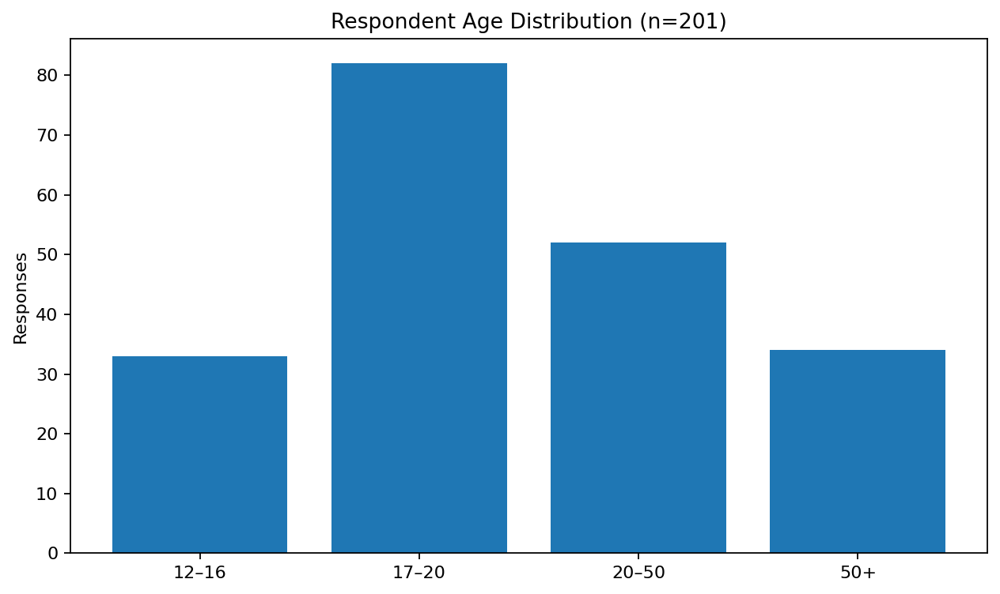

## 4.2 Habitual AI use

| Response | Responses | Percentage |
|---|---:|---:|
| Use AI frequently | 86 | 42.8% |
| Use AI sometimes | 70 | 34.8% |
| Use AI rarely | 36 | 17.9% |
| Do not use AI | 9 | 4.5% |

Overall, 192 of the 201 respondents reported using AI at least occasionally.

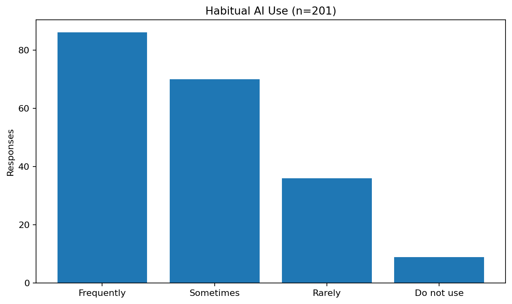

### Age and AI use

The repository also includes a cross-tabulation of age group and reported AI usage. This provides additional context for interpreting the survey's demographic composition rather than treating age and AI familiarity as unrelated variables.

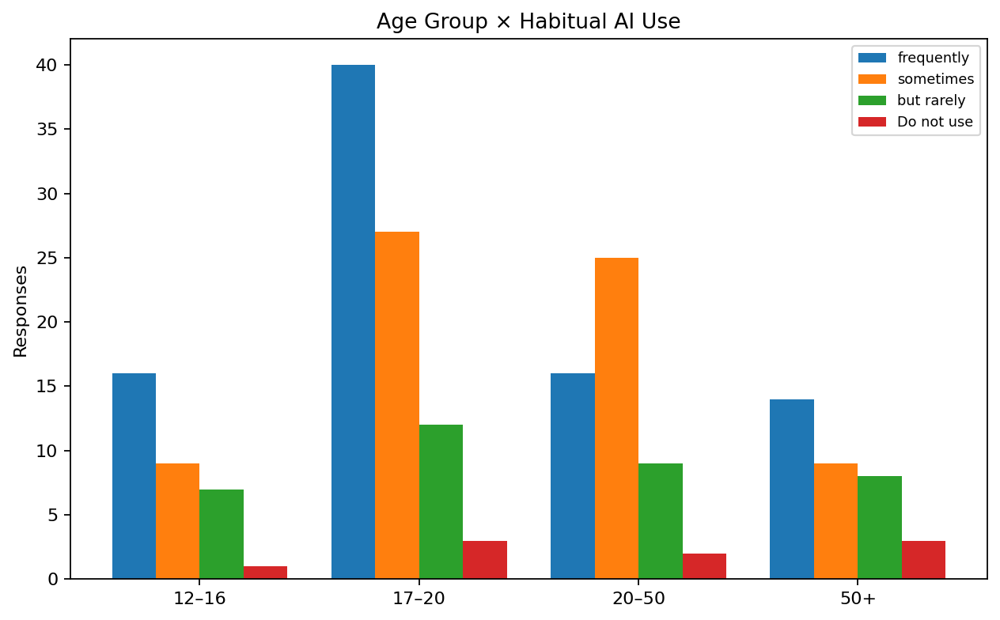

---

## 4.3 Expected role of AI and autonomous systems

Respondents rated their agreement with the statement that AI and autonomous systems will play a key role in future conflicts on a five-point scale.

- Mean score: **3.81 / 5**
- Rating 4: **79 respondents (39.3%)**
- Rating 5: **62 respondents (30.8%)**
- Ratings 4–5 combined: **141 respondents (70.1%)**

The result indicates substantial agreement among this sample with the proposition that AI and autonomous systems will have an important role in future conflicts.

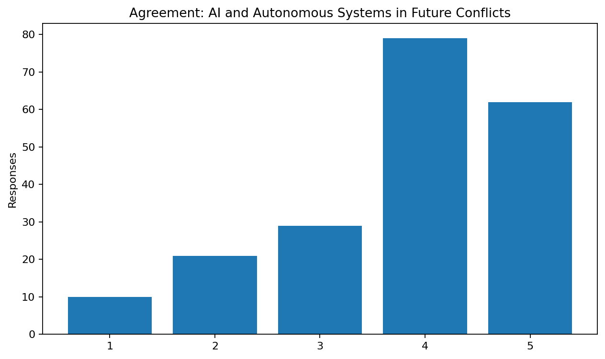

---

## 4.4 Perceived risks

This was a select-all-that-apply question, so percentages do not sum to 100%.

| Perceived risk | Responses | Percentage |
|---|---:|---:|
| Vulnerability to cyber attacks/hacking/cyber-poisoning | 165 | 82.1% |
| Unintended civilian casualties | 94 | 46.8% |
| Burden of human accountability shifted | 86 | 42.8% |
| Rapid escalation of war | 71 | 35.3% |

Cybersecurity-related vulnerability was the most frequently selected predefined risk.

Sixteen responses also supplied additional "Other" text. These were retained as qualitative information rather than being silently converted into new standardized categories.

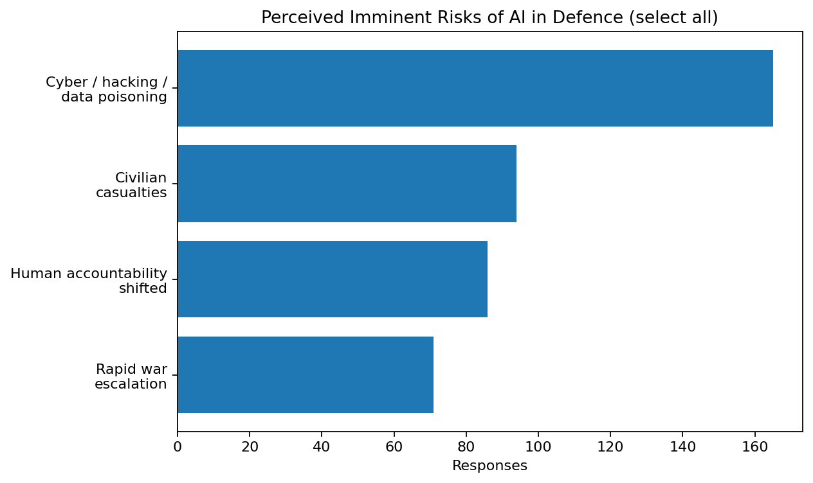

---

## 4.5 Responsibility for unintended civilian casualties

Among the three predefined choices:

| Response | Responses | Percentage |
|---|---:|---:|
| Both the AI system/developers and official/supervisor | 117 | 58.2% |
| Official/supervisor responsible for the decision | 66 | 32.8% |
| AI system and its developers | 6 | 3.0% |

The remaining **12 responses** used the form's "Other" field. These responses varied from assigning responsibility to governments or senior authorities to expressing uncertainty about how responsibility should be determined. They are not silently reassigned to the three predefined categories.

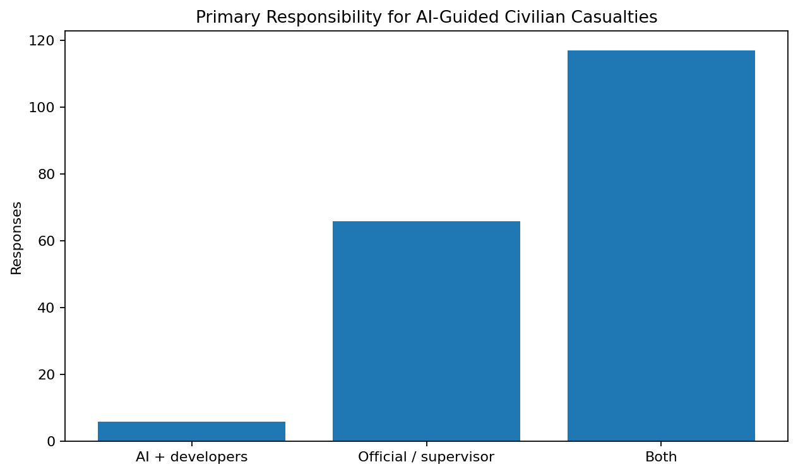

---

## 4.6 International regulation

| Response | Responses | Percentage |
|---|---:|---:|
| Yes | 187 | 93.0% |
| No | 14 | 7.0% |

A large majority of respondents supported the adoption or establishment of international legal conventions or treaties regulating AI in warfare.

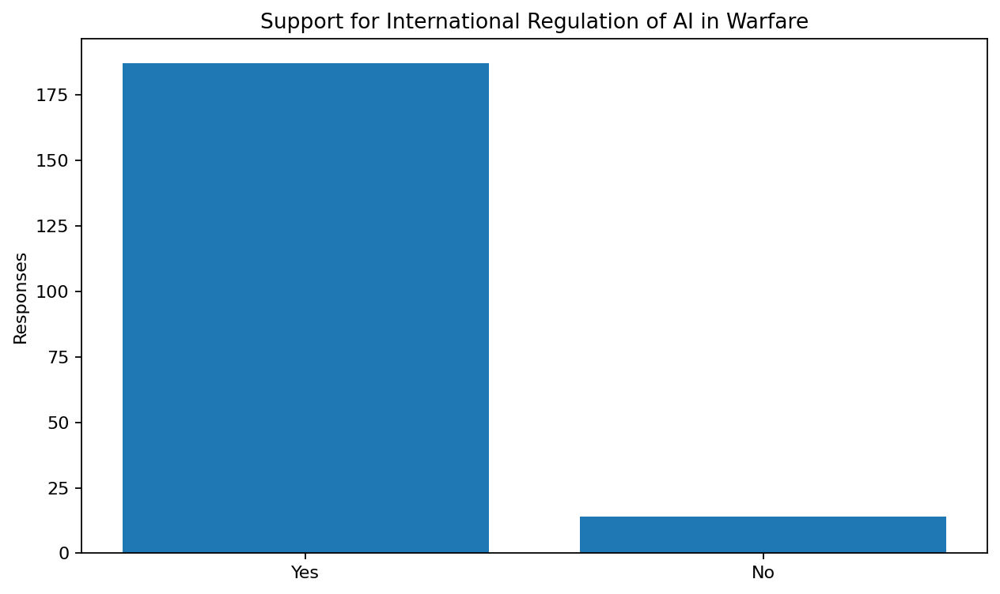

---

## 4.7 AI-generated sensitive information for targeting

Respondents rated the ethical permissibility of using AI models to generate summaries of sensitive information for efficient and selective targeting on a five-point scale.

| Rating | Responses | Percentage |
|---|---:|---:|
| 1 | 22 | 10.9% |
| 2 | 34 | 16.9% |
| 3 | 65 | 32.3% |
| 4 | 48 | 23.9% |
| 5 | 32 | 15.9% |

Mean score: **3.17 / 5**.

The distribution was centred around the middle of the scale rather than concentrated entirely at either extreme.

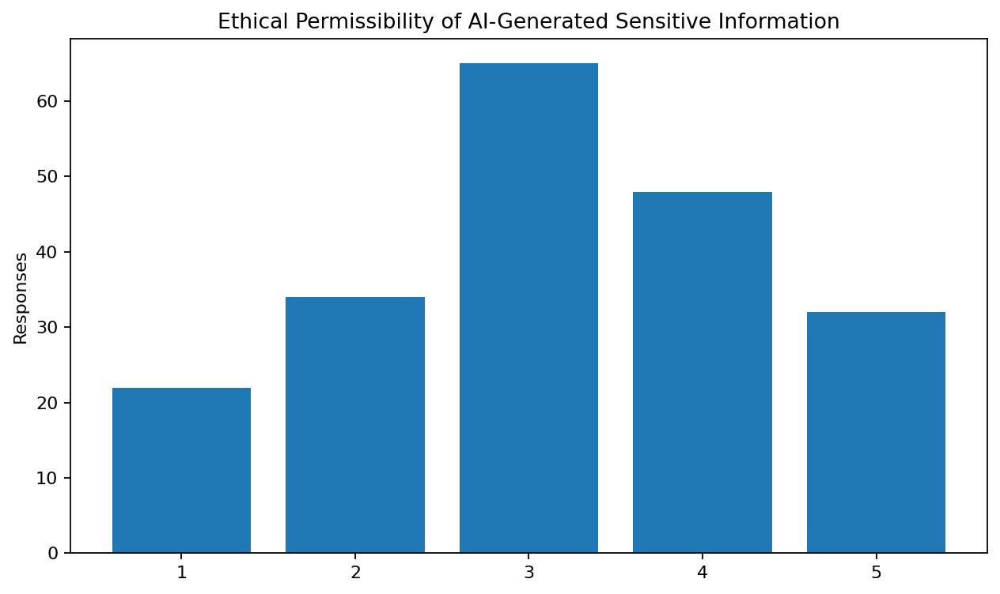

---

## 4.8 Automated combatants

This question was open-ended:

> How efficient would automated combatants be in comparison to their human counterparts, considering that they may not be prone to physical, psychological and emotional problems?

There were **192 substantive responses and 9 missing responses** in the export.

The written responses showed several recurring considerations:

- potential advantages in endurance and resistance to fatigue;
- possible gains in consistency or physical performance;
- concerns about hacking and system reliability;
- concerns about the absence of human emotional and moral judgment;
- dependence on training data and system design;
- the possibility that technical efficiency could coexist with ethical or strategic problems.

Because this was an open-ended question rather than a predefined scale, the project does not convert these answers into an invented numerical score.

See [`findings.md`](findings.md) for the qualitative-analysis framework.

---

## 4.9 Access to citizens' personal information

| Response | Responses | Percentage |
|---|---:|---:|
| No, definitely not | 104 | 51.7% |
| Yes, but partially under mandated democratic guidelines | 91 | 45.3% |
| Yes, complete access | 6 | 3.0% |

The responses show substantial concern about unrestricted access, while a large portion of the sample supported conditional access under stated safeguards.

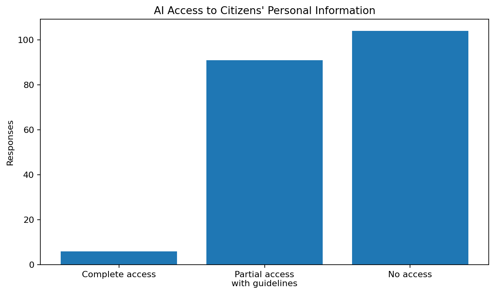

---

## 4.10 Pre-emptive AI action

The direct Google Forms selections were:

| Response | Responses | Percentage |
|---|---:|---:|
| Yes, but only after seeking confirmation with the operator in charge | 160 | 79.6% |
| Yes, at its own discretion | 4 | 2.0% |
| No | 6 | 3.0% |
| Other/free-text | 31 | 15.4% |

The 31 "Other" responses were individually reviewed. Several clearly expressed positions equivalent to one of the predefined choices, while others were ambiguous or non-committal.

For methodological transparency, the repository **does not overwrite the original Google Forms counts** with subjective recoding. A separate semantic audit records the manual interpretation of these responses.

This distinction matters because a researcher should be able to reproduce the original form result and also see where interpretive cleaning was considered.

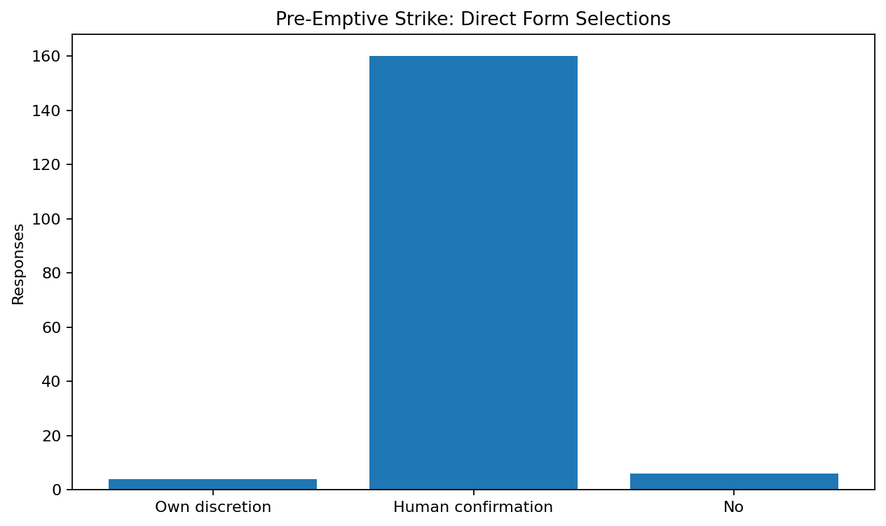

---

## 4.11 Trolley-problem scenario

The survey asked respondents whether an AI capable of saving several soldiers by sacrificing one should be allowed or programmed to do so, and requested an explanation.

The responses reveal a substantive divide between:

- arguments based on minimising casualties or saving the greater number of people;
- objections to allowing a machine to assign relative value to human lives;
- positions allowing such action only under human authorization;
- conditional responses depending on circumstances, certainty, alternatives and the identity or role of those involved;
- responses arguing that the first priority should be to find a way to save everyone.

Because the question deliberately requested explanation, the repository treats it as a **qualitative ethical question**, not as a binary yes/no statistic.

---

## 4.12 Inviolable boundaries

The open-ended boundary question produced a wide range of responses. Recurring areas of concern included:

- fully autonomous lethal decision-making;
- taking human life without human authorization;
- unrestricted control over weapons or critical defence decisions;
- loss of human oversight;
- access to sensitive or personal information;
- compromising national defence secrets;
- uncontrolled escalation;
- nuclear or mass-casualty decisions;
- hacking and system manipulation.

These themes overlap substantially with the project's quantitative findings on accountability, privacy, cybersecurity and human oversight.

---

## 4.13 Do the benefits outweigh the drawbacks?

| Rating | Responses | Percentage |
|---|---:|---:|
| 1 | 20 | 10.0% |
| 2 | 37 | 18.4% |
| 3 | 78 | 38.8% |
| 4 | 45 | 22.4% |
| 5 | 21 | 10.4% |

Mean score: **3.05 / 5**.

The distribution is centred on the midpoint, rather than indicating a uniformly positive or negative assessment.

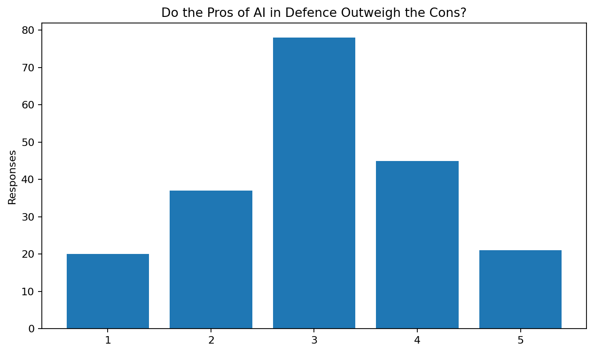

---

# 5. Background Research

The research component examines how AI is being discussed and developed in the context of modern defence, including:

- intelligence and surveillance;
- predictive and analytical systems;
- logistics and decision support;
- cybersecurity;
- autonomous systems;
- accountability and human oversight;
- privacy and sensitive information;
- international regulation and governance.

The research section is intentionally distinguished from the survey results. The survey measures the views of the 201 respondents; the research section provides external context for interpreting those views.

See [`research.md`](research.md).

---

# 6. Integrated Research Article

The project report also contains an article-style discussion titled **"Use of Artificial Intelligence in the Defence Industry"**. It is part of the Research section of the project rather than a separate study.

The article discusses AI's growing role in defence, its potential advantages, cybersecurity and ethical concerns, international developments, and the importance of retaining human judgment and accountability.

See [`research.md`](research.md).

---

# 7. Discussion

Taken together, the survey results describe respondents who generally recognise a significant future role for AI in defence while expressing substantial concern about the consequences of giving AI unrestricted authority.

Several findings point in the same direction:

- 70.1% rated the future-conflict statement at 4 or 5.
- Cybersecurity-related vulnerability was selected by 82.1%.
- 93.0% supported international regulation.
- 51.7% rejected unrestricted AI access to citizens' personal information, while another 45.3% supported only conditional access.
- The pre-emptive-strike question produced a strong direct-selection concentration on human confirmation.
- The advantages-versus-disadvantages scale averaged 3.05/5, indicating a distribution centred around the middle rather than an overwhelmingly positive response.

These results should be read as **patterns within this sample**, not as measurements of the views of an entire country or population.

---

# 8. Reflection and Conclusion

The project suggests that respondents are neither uniformly opposed to AI in defence nor uniformly supportive of unrestricted military autonomy.

AI was generally viewed as capable of providing useful assistance, particularly where rapid data processing, endurance, analysis or cybersecurity could be valuable. At the same time, the responses repeatedly returned to the limits of machine decision-making when questions involved human life, moral judgment, accountability and privacy.

The central theme emerging from the project is therefore the distinction between **AI assistance and AI authority**.

The survey responses generally supported the idea that AI can assist defence decision-making while expressing stronger reservations about allowing AI to become the final authority over decisions involving human life.

This conclusion belongs to the project authors. It should not be interpreted as a claim that the survey proves what society as a whole believes.

See [`findings.md`](findings.md).

---

# 9. Limitations

This study has several important limitations.

### Sampling

The survey used voluntary convenience sampling through school contacts, WhatsApp and personal contacts. The sample is therefore not a probability sample and should not be treated as statistically representative of India's population or of the global population.

### Sample composition

The 201 respondents were distributed unevenly across age groups, with the 17–20 group forming the largest category.

### Self-reported opinions

The study measures respondents' stated opinions. It does not measure their technical knowledge, professional experience, or actual behaviour concerning AI.

### Hypothetical scenarios

Several questions describe hypothetical situations involving AI and warfare. Responses to hypothetical scenarios may differ from responses to real operational situations.

### Open-ended responses

The qualitative questions produced highly varied answers. The repository uses thematic interpretation rather than presenting those responses as a single numerical variable.

### Data completeness

The automated-combatant question contains nine missing responses despite being marked required in the original form export. The optional final suggestions field also contains many missing responses.

### Survey instrument

Some questions concern complex legal and ethical issues that cannot be completely represented by a single multiple-choice question or rating scale.

---

# 10. Reproducibility and Data Handling

The repository is designed to document the research without exposing identifiable respondent information.

Publicly included:

- survey questionnaire;
- aggregate response counts;
- percentages;
- generated charts;
- data-quality audit;
- qualitative-analysis framework;
- research documentation;
- conclusion and limitations.

Not publicly included:

- respondent names;
- the original respondent-level spreadsheet;
- individual timestamps;
- identifiable individual responses.

The aggregate results can be inspected in [`data/aggregate-results.csv`](data/aggregate-results.csv).

---

# 11. Sources and References

The original project consulted a mixture of online articles and locally held research documents.

### Sources cited in the original project

1. **AI DOCUMENT IMP.pdf** — a document consulted during the original research process. The original file is not redistributed in this repository.
2. **Factsheet AI in Defence.pdf** — a document consulted during the original research process. The original file is not redistributed in this repository.
3. Times of India — *AI, autonomous systems to play decisive role in future conflicts: CDS*.
4. The Hindu — *MoD study on AI-powered weapons highlights gap between India's aspirations and capabilities*.
5. Deccan Herald — *Need to boost AI, autonomous system capability for future warfare: Defence Minister Rajnath Singh*.

The source list is documented in [`references.md`](references.md).

---

# 12. Project Team

### Project Team
Four-member student research team:

**R · D · Ar · Ab**

### Team leadership and planning
**D** — team leader and project planning.

### Contribution breakdown

| Member | Contribution |
|---|---|
| **R** | Research, cover-page development, analysis of survey results |
| **D** | Timeline, research, analysis of survey results, team leadership and planning |
| **Ar** | Google Form survey, objective and purpose, introduction |
| **Ab** | Reflection and conclusion |

The contribution record is also available in [`team.md`](team.md).

---

# 13. Disclaimer

This repository documents a student-led survey research project. It does not represent the views, policies or positions of any government, military organisation, defence agency or other institution.

The survey findings describe the respondents included in this study and should not be interpreted as a nationally or globally representative public-opinion measurement.

---

## Repository Structure

```text
use-of-ai-in-the-defence-industry/
├── README.md
├── survey.md
├── findings.md
├── research.md
├── data.csv
├── data-notes.md
├── references.md
├── team.md
├── .gitignore
└── assets/
    └── figures/
```

The repository is intentionally kept compact: the README is the main entry point, while the other files contain the survey, findings, research, data, references and team information.

## Project Status

**Completed survey collection and analysis documentation**

The repository preserves the original survey evidence while separating direct response statistics, qualitative interpretation, background research and author conclusions.
